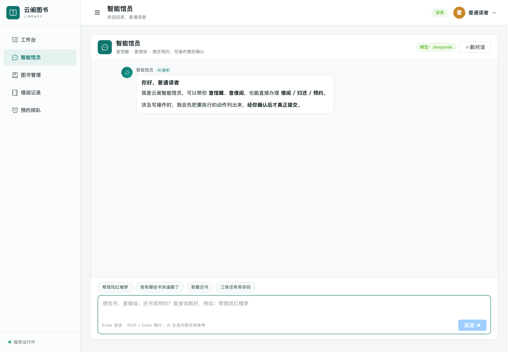
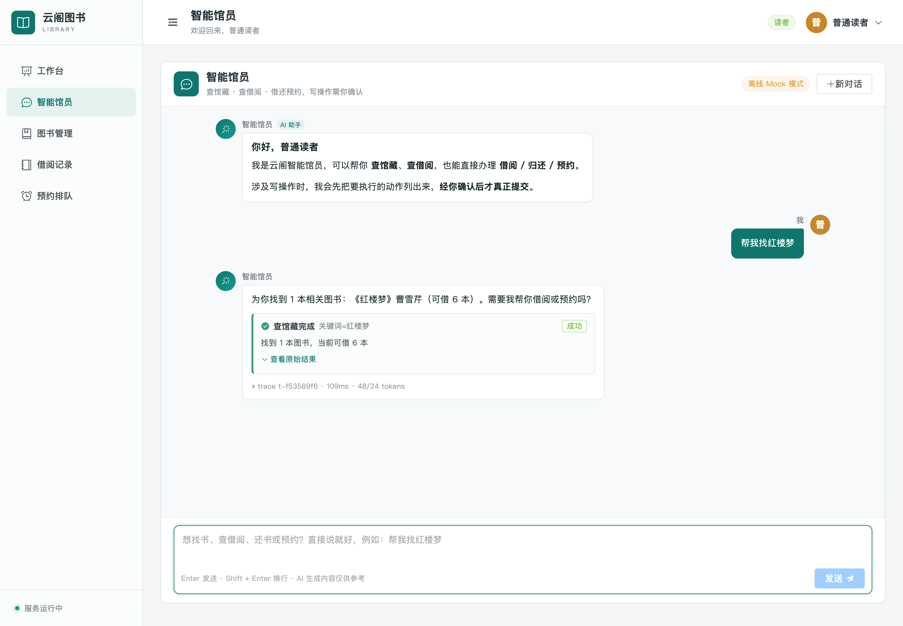
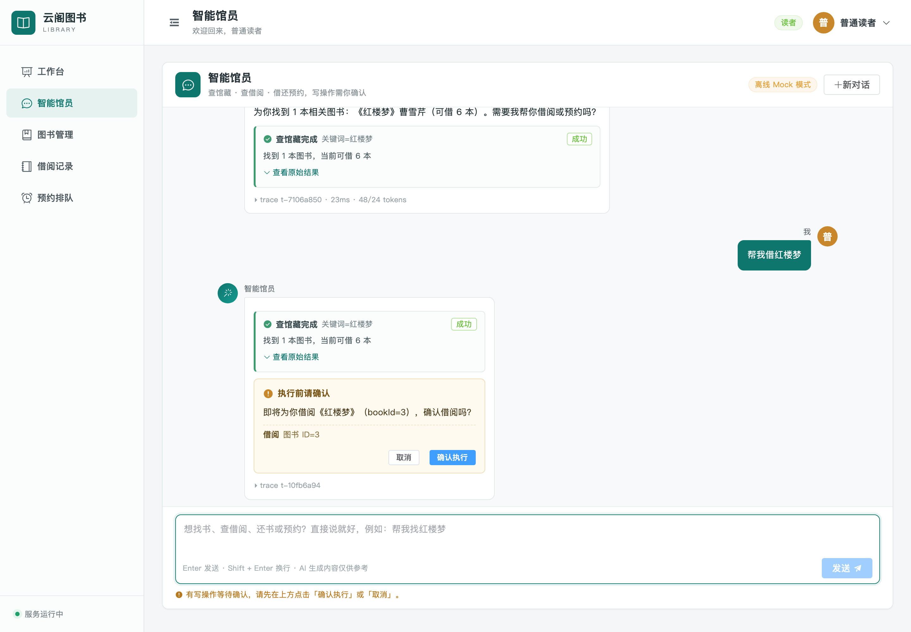
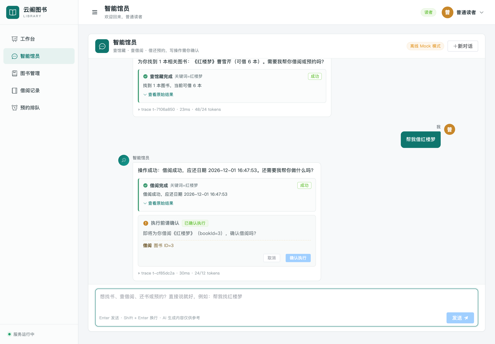

# 云阁图书借阅系统

一个精简但完整的在线图书借阅系统。后端使用 Spring Boot、MyBatis-Plus、MySQL 和 Redis，前端使用 Vue 3 与 Element Plus。

## 功能范围

- 用户模块：管理员与普通读者登录、Redis token 登录态、简单 RBAC、用户管理
- 图书模块：图书列表、关键词与分类筛选、分页、新增、编辑、删除
- 借阅模块：借书、续借、还书、借阅记录、逾期状态、逾期罚金结算
- 借阅规则中心：借阅上限、借期、续借次数、每日罚金与封顶、预约上限与保留时长
- 预约排队：库存不足时可预约，归还后按队列通知取书，超时自动顺延给下一位读者
- 操作日志：AOP 记录关键操作的人员、参数、结果与耗时，自动保留最近 90 天
- 工作台：馆藏、库存、读者、借出、逾期、预约和归还统计
- 工程能力：Maven、Lombok、Hutool、MyBatis-Plus、Spring AOP、定时任务、全局异常处理、参数校验

## AI 原生改造（W2 已完成）

在原有业务系统之上新增一层 AI 应用服务，把「借书 / 还书 / 预约 / 查借阅」变成可以用自然语言完成的 Agent 能力。设计原则与接口契约见 [docs/AI-架构与接口契约.md](docs/AI-架构与接口契约.md)。

全量任务拆解（W0–W4，含已完成项的证据与待办项的验收标准）见 [docs/AI改造任务清单-W0-W4.md](docs/AI改造任务清单-W0-W4.md)。

```text
Vue3 ──SSE──▶ ai-service（Python + FastAPI + LangGraph）
                    │ 内部工具调用（转发用户 token + X-Internal-Token）
                    ▼
              backend（Spring Boot，复用现有事务与 RBAC）
```

| 模块 | 位置 | 状态 |
| --- | --- | --- |
| AI 内部工具 API（8 个端点，身份透传、防公网、写操作复用现有事务） | `backend/src/main/java/com/library/ai/` | ✅ W1 |
| Python AI 服务（LangGraph Agent、6 个工具、SSE、人在回路确认、模型网关/降级、mock 离线模式） | `ai-service/` | ✅ W1 |
| 本地编排（MySQL / Redis / pgvector / AI 服务） | `docker-compose.yml` | ✅ W1 |
| 流式对话前端（打字机、工具调用轨迹、人在回路确认卡片、移动端适配） | `frontend/src/views/ChatView.vue` | ✅ W2 |
| 会话持久化（Redis 存历史与确认状态，服务重启不丢；Redis 不可用自动降级） | `ai-service/app/memory/redis_store.py` | ✅ W2 |
| 生产部署配套（nginx SSE 代理、内部接口封禁、SPA 路由） | `deploy/nginx/library.conf` | ✅ W2 |

本地跑通（mock 模型，无需任何 API Key）：

```bash
# 方式一：一键脚本（隔离 MySQL，不碰本机 3306；自动起后端 + AI 服务）
bash scripts/dev_up.sh
cd frontend && npm run dev                # 前端 :5173（已配好 /api 与 /api/ai 代理）
# 打开 http://localhost:5173/chat → 用 reader / reader123 登录 → 说「帮我借红楼梦」

# 方式二：docker compose（MySQL/Redis/pgvector/AI 服务容器化）
cp .env.example .env
docker compose up -d
cd backend && mvn spring-boot:run

# 停止：bash scripts/dev_down.sh
```

> 对话页必须经 Vite（开发）或 nginx（生产）访问，因为 `/api/ai/**` 需要被代理到 Python AI 服务；
> 直接访问 `http://127.0.0.1:18080/chat` 页面能打开，但 AI 请求会 404。

界面效果（`scripts/ui_screenshot.mjs` 无头 Chrome 自动走查生成，可重跑）：

| 欢迎态 + 快捷问题 | 工具调用轨迹 |
| --- | --- |
|  |  |

| 写操作确认卡片（人在回路） | 确认后真实借阅成功 |
| --- | --- |
|  |  |

验证与数据：

| 验证项 | 命令 | 结果 |
| --- | --- | --- |
| 后端单测（含原有业务测试） | `cd backend && mvn -B clean test` | 71 passed |
| AI 服务单测 | `ai-service/.venv/bin/python -m pytest ai-service -q` | **158 passed** |
| 端到端（16 项断言：身份透传/人在回路/真实落库） | `ai-service/.venv/bin/python scripts/e2e_ai.py` | 全绿 |
| 会话跨重启持久化 | `ai-service/.venv/bin/python ai-service/scripts/verify_redis_persistence.py` | 重启后历史仍在 |
| 界面截图 | `node scripts/ui_screenshot.mjs` | 生成 4 张关键状态图 |
| 真实模型兼容性（填 Key 后） | `ai-service/.venv/bin/python scripts/check_llm.py` | 连通性 / function calling / 首 token 延迟 |
| 只读压测 | `python3 docs/loadtest.py --token <token> --paths "/api/books" --levels 10,25 --duration 15` | 见 `docs/压测报告.md` |
| RAG 语料构建（离线幂等） | `cd ai-service && .venv/bin/python scripts/build_corpus.py` | 535 块（book 500 / rule 5 / faq 30） |
| RAG 检索评测（离线，无需 Key） | `cd ai-service && .venv/bin/python scripts/run_eval.py` | Recall@5 **0.973** / MRR **0.859**，见 [docs/RAG评测报告.md](docs/RAG评测报告.md) |

> 当前默认 `LLM_PROVIDER=mock`（离线、无需 Key、回复确定性），方便演示与 CI；换成 DeepSeek/Qwen 只需改 `.env` 两行。

## 目录结构

```text
.
├── backend/   # Spring Boot 3.5.x 服务端，最终包含前端静态资源
└── frontend/  # Vue 3 + Vite + Element Plus 客户端
```

## 本地环境

- JDK 17+
- Maven 3.9+
- Node.js 20+
- MySQL 8.x
- Redis 6+

数据库会自动执行 `backend/src/main/resources/schema.sql` 和 `data.sql`，其中 `data.sql` 会幂等写入 1 个管理员、5 个读者和 500 本示例图书（重复执行不会产生重复数据）。首次启动前只需创建数据库：

```sql
CREATE DATABASE library_db CHARACTER SET utf8mb4 COLLATE utf8mb4_unicode_ci;
```

已有数据库升级到当前版本时，先执行一次 `backend/src/main/resources/db/upgrade-2026-10.sql`（新增借阅规则、预约排队、操作日志表以及借阅记录的续借 / 罚金字段），新环境无需执行。

默认连接配置位于 [application.yml](backend/src/main/resources/application.yml)，均可通过环境变量覆盖。

## 开发运行

启动后端：

```bash
cd backend
mvn spring-boot:run
```

另开终端启动前端：

```bash
cd frontend
npm install
npm run dev
```

访问 `http://localhost:5173`，Vite 会将 `/api` 代理到 `http://127.0.0.1:18080`。

默认账号：

| 角色 | 用户名 | 密码 |
| --- | --- | --- |
| 管理员 | `admin` | `admin123` |
| 读者 | `reader` | `reader123` |
| 读者 | `reader2` ~ `reader5` | `reader123` |

## 一键打包

```bash
./build.sh
```

脚本会先构建 Vue 前端并输出到 `backend/src/main/resources/static`，再打包出包含前端页面的 Spring Boot 可执行 jar：

```bash
java -jar backend/target/library-server.jar
```

## 常用环境变量

| 变量 | 默认值 | 说明 |
| --- | --- | --- |
| `SERVER_PORT` | `18080` | 服务端口 |
| `DB_URL` | 本机 `library_db` | JDBC 连接串 |
| `DB_USERNAME` | `root` | 数据库用户 |
| `DB_PASSWORD` | `root` | 数据库密码 |
| `REDIS_HOST` | `127.0.0.1` | Redis 地址 |
| `REDIS_PORT` | `6379` | Redis 端口 |
| `REDIS_PASSWORD` | 空 | Redis 密码 |
| `TOKEN_TTL` | `604800` | token 有效期，单位秒 |
| `SQL_INIT_MODE` | `always` | 首次部署后可设为 `never` |

生产部署已切换到独立的 MySQL、Redis 和系统账号，未使用演示密码。中文的演示、日常发布与从零部署指南见 [docs/ECS部署与演示指南.md](docs/ECS部署与演示指南.md)，日常发布一条命令即可：`./deploy/push.sh`；服务器运维细节见 [deploy/README.md](deploy/README.md)。
