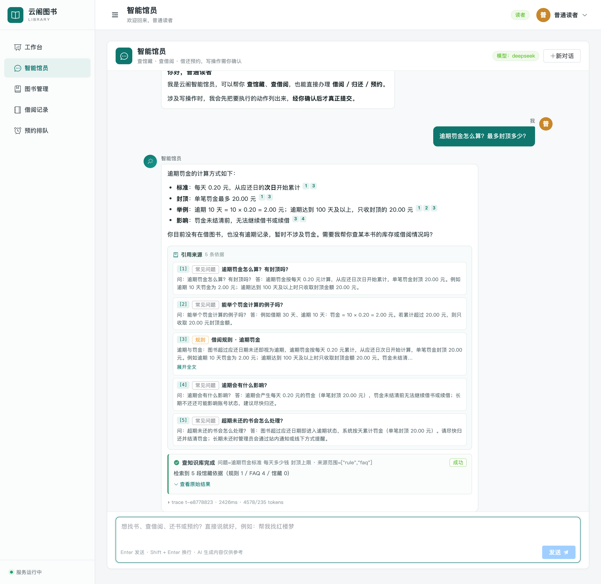
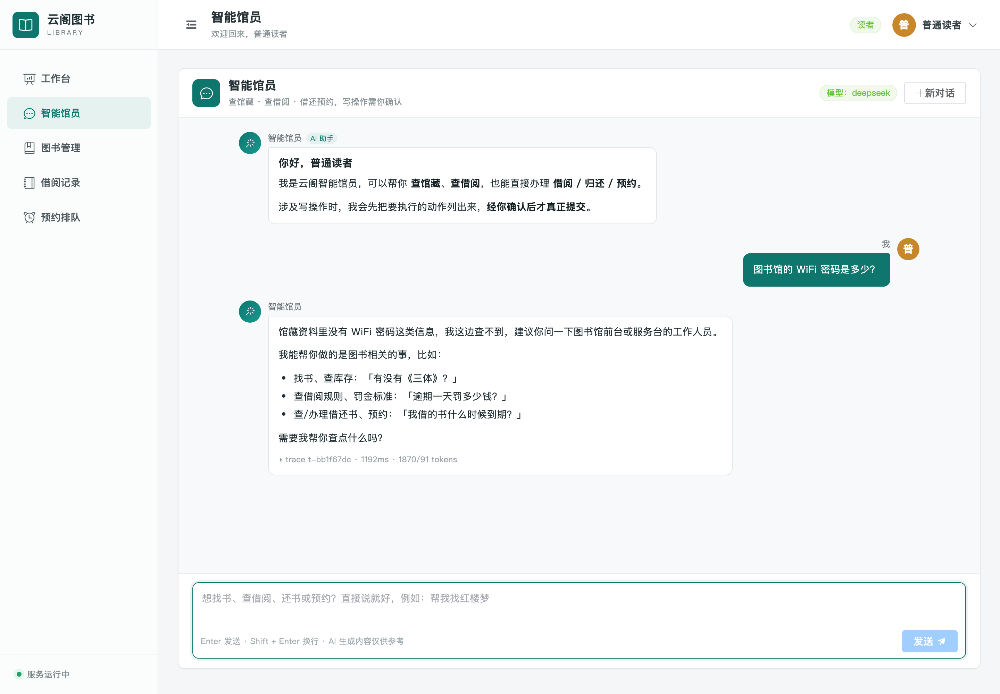
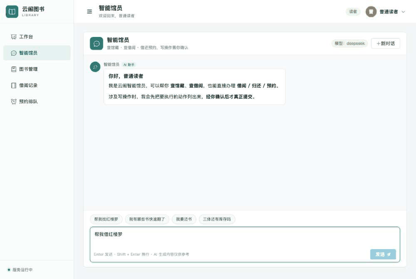

# 云阁图书馆 · AI 原生借阅系统

[](https://github.com/lxl9527414/library-borrowing-system/actions/workflows/ci.yml) [](LICENSE)

> 仓库地址：https://github.com/lxl9527414/library-borrowing-system


一个**传统图书借阅业务系统 + AI 应用层**的完整实践：

- 业务层：Spring Boot 3.5 + MyBatis-Plus + MySQL + Redis + Vue 3（原有系统，含借阅规则、预约排队、AOP 操作日志）
- AI 层：Python + FastAPI + **LangGraph Agent** + 通义/DeepSeek 模型 + **RAG 知识问答**（向量检索 + 引用溯源 + 拒答）
- 关键设计：**AI 不直连数据库**、写操作**人在回路确认**、身份**只从 token 解析**（LLM 无法伪造成他人）

> 目标不是"加一个聊天框"，而是让 AI 成为业务系统的一等公民入口：能查、能操作真实数据，且被权限、确认与评测约束。

---

## 这个项目能说明什么（数字都是实测，可复现）

| 能力 | 证据 |
|---|---|
| **Agent 工具调用 + 人在回路** | 7 个工具、写操作确认卡、越权拦截；端到端 **16 项断言**全绿（`scripts/e2e_ai.py`） |
| **RAG 检索质量** | 535 块语料；向量检索 **Recall@5 1.000 / MRR 0.916**；rule 类 MRR 0.394 → 0.578 |
| **RAG 答案质量** | faithfulness **0.940** / answer relevancy **0.971** / 引用准确率 **0.913** / 拒答 **9/10** |
| **工程规范** | 后端 **71** 个单测 + AI 服务 **319** 个单测（全离线）；CI 五 job |
| **性能与成本** | 模型 TTFT **P50 897 ms**、输出 **84 字/秒**；单轮对话 **≈¥0.0094**（每千次 ≈¥9.4） |
| **可观测与容错** | SSE 流式、模型网关降级、Redis 会话跨重启、重排/向量/Redis 全部可优雅降级 |

评测方法与全部数字：
[RAG 评测报告](docs/RAG评测报告.md) · [AI 性能与成本报告](docs/AI性能与成本报告.md) · [压测报告](docs/压测报告.md)

---

## 架构

```text
┌───────────────────────────────┐
│  Vue 3 前端（Element Plus）    │  对话页：流式打字机 / 工具轨迹 / 确认卡 / 引用卡
└───────────────┬───────────────┘
                │ SSE（/api/ai/chat、/api/ai/chat/confirm）
┌───────────────▼───────────────────────────────┐
│  ai-service（Python 3.10 / FastAPI）           │
│  ├─ LangGraph：agent → authorize(interrupt)   │  ← 写操作在这里暂停等确认
│  │              → tools → agent                │
│  ├─ RAG：BM25 + 向量检索(+RRF) + gte-rerank    │  535 块 / 1024 维
│  ├─ 模型网关：DeepSeek / 通义 / Ollama，降级链 │
│  └─ 记忆：Redis（会话/确认态 TTL）             │
└───────────────┬───────────────────────────────┘
                │ 内部工具 API（转发用户 token + X-Internal-Token）
┌───────────────▼───────────────────────────────┐
│  backend（Spring Boot，原有业务系统）          │
│  RBAC / 事务 / 借阅规则 / 预约队列 / AOP 日志  │
└───────────────┬───────────────────────────────┘
        MySQL 8 ─┤─ Redis 7 ─┘
```

**四条硬约束**（对应 [ADR](docs/ADR.md)）：
1. AI 层不直连数据库，一切读写回到业务层（事务/规则单一事实来源）
2. 身份只由 `Authorization` token 决定，LLM 无法指定 userId
3. 写操作（借/还/预约）必须用户确认后才执行
4. 每个 AI 能力都要有可复现的评测数字，没有数字不算完成

---

## 界面

| 知识问答（带引用溯源） | 写操作确认（人在回路） |
|---|---|
|  |  |

| 工具调用轨迹 | 无依据时明确拒答 |
|---|---|
|  |  |

> 截图由 `scripts/ui_screenshot.mjs` 驱动无头 Chrome 自动走查生成（自写 CDP，不依赖 Playwright），可随时重跑。

## 一键演示（真实模型）

```bash
bash scripts/demo.sh      # 起依赖 → 走完整流程 → 录制成 docs/demo.gif
```

演示内容：说「帮我借红楼梦」→ 查馆藏 → **写操作确认卡** → 点确认 → 真实落库 → 问「逾期罚金怎么算」→ **带 [1] 引用的回答 + 来源卡片**。



> 录制实现：CDP `Page.startScreencast` 录帧 + Pillow 合成 GIF（**不依赖 ffmpeg**）；
> 帧去重会合并静止段、保留有变化的帧（`scripts/demo_record.mjs`、`scripts/frames_to_gif.py`）。

---

## 快速开始（本地，无需任何 API Key）

```bash
# 1) 一键起：隔离 MySQL(3308) + 后端(18080) + AI 服务(8000)，不碰你本机的 3306
bash scripts/dev_up.sh

# 2) 前端（5173，已配好 /api 与 /api/ai 代理）
cd frontend && npm install && npm run dev

# 3) 浏览器打开 http://localhost:5173/chat
#    读者账号：reader / reader123    管理员：admin / admin123
```

想做真实模型演示：在 `.env` 填 `LLM_PROVIDER=deepseek` + `DEEPSEEK_API_KEY=...` 后重启
（先跑 `ai-service/.venv/bin/python scripts/check_llm.py` 自检连通性/function calling/TTFT）。

停止：`bash scripts/dev_down.sh`

> 对话页必须经 Vite（开发）或 nginx（生产）访问——`/api/ai/**` 需要被代理到 Python 服务；
> 直接开 `http://127.0.0.1:18080/chat` 页面能显示，但 AI 请求会 404。

### 也可以用 Docker Compose

```bash
cp .env.example .env
docker compose up -d          # MySQL / Redis / pgvector / AI 服务
cd backend && mvn spring-boot:run
```

---

## 功能清单

**业务（原有系统）**
- 用户与权限：管理员/读者登录、Redis token、RBAC、用户管理
- 图书：检索/筛选/分页/增删改
- 借阅：借书、续借、还书、逾期与罚金结算
- 借阅规则中心：借阅上限、借期、续借次数、每日罚金与封顶、预约上限与保留时长
- 预约排队：库存不足可预约，归还后按队列通知，超时自动顺延
- 操作日志：AOP 记录人员/参数/结果/耗时（含 AI 工具调用），保留 90 天
- 工作台：馆藏、库存、读者、借出、逾期、预约统计

**AI（新增）**
- 智能馆员：自然语言找书、查借阅、借书/还书/预约（写操作需确认）
- 知识问答：借阅规则/罚金/预约/流程类问题，带 `[1]` 引用与来源卡片，无依据时拒答
- 回答可溯源：正文 `[n]` → 引用卡片（类型/标题/摘要/展开/跳转）
- 多模型：DeepSeek / 通义 / Ollama 可切换，网关带超时、重试、降级
- 离线模式：内置 mock 模型，无 Key 也能完整演示与跑测试

---

## 验证与质量

| 验证项 | 命令 | 结果 |
|---|---|---|
| 后端单测 | `cd backend && mvn -B clean test` | 71 passed |
| AI 服务单测（全离线） | `ai-service/.venv/bin/python -m pytest ai-service -q` | 319 passed |
| Agent 端到端（身份/确认/落库） | `ai-service/.venv/bin/python scripts/e2e_ai.py` | 16 项断言全绿 |
| RAG 端到端（真模型） | `ai-service/.venv/bin/python scripts/e2e_rag.py` | 5 类问题全绿 |
| RAG 语料 / 索引 | `scripts/build_corpus.py` / `index_corpus.py` | 535 块 / 535×1024（幂等） |
| RAG 检索评测 | `scripts/run_eval.py` | 六档对比见 [报告](docs/RAG评测报告.md) |
| RAG 答案层评测 | `scripts/eval_answers.py` | faithfulness 0.940 / 引用 0.913 |
| 模型基准 | `scripts/bench_llm.py` | TTFT P50 897ms / 84 字每秒 |
| 界面截图 + 回归 | `node scripts/ui_screenshot.mjs` | 7 张关键状态图 |
| 只读压测 | `python3 docs/loadtest.py --token <token> ...` | 见 [压测报告](docs/压测报告.md) |

---

## 技术决策

8 条关键决策的「背景 / 选项 / 决策 / 代价」见 **[docs/ADR.md](docs/ADR.md)**：
双栈为何、AI 为何不直连 DB、为何要人在回路、mock 的价值、向量库选型、重排选型、RAGAS 自研原因、SSE vs WebSocket。

全量任务拆解（W0–W4，含每项验收标准与证据）见 **[docs/AI改造任务清单-W0-W4.md](docs/AI改造任务清单-W0-W4.md)**；
接口契约见 **[docs/AI-架构与接口契约.md](docs/AI-架构与接口契约.md)**。

---

## 目录结构

```text
.
├── backend/                  # Spring Boot 3.5：业务 + /api/ai/internal 工具 API
│   └── src/main/java/com/library/ai/   # AI 内部工具层（8 端点、身份透传、防公网）
├── ai-service/               # Python AI 服务
│   ├── app/agent/            # LangGraph 状态机（确认/工具/引用）
│   ├── app/tools/            # 7 个工具（schema + executor + 阈值）
│   ├── app/rag/              # 语料/BM25/embedding/向量库/重排/检索服务
│   ├── scripts/              # 建语料、建索引、评测、基准
│   └── tests/                # 319 个离线测试
├── frontend/                 # Vue 3 + Element Plus（含对话页与引用卡片）
├── docs/                     # 契约、任务清单、RAG 评测、性能成本、ADR、截图
├── scripts/                  # dev_up/dev_down、e2e、截图、模型自检、基准
└── deploy/                   # nginx / systemd / 发布脚本
```

---

## 默认账号（种子数据）

| 角色 | 用户名 | 密码 |
|---|---|---|
| 管理员 | `admin` | `admin123` |
| 读者 | `reader` ~ `reader20`（共 20 个） | `reader123` |

> 这是 `data.sql` 里的种子账号，供全新环境使用；你自己的 `.env` 里可以配置本地演示账号（`DEMO_USER/DEMO_PASSWORD`），
> 脚本会优先读它。

---

## 本地环境

- JDK 17+、Maven 3.9+、Node.js 20+、MySQL 8.x、Redis 6+
- 数据库会自动执行 `schema.sql` 与 `data.sql`（幂等写入 1 个管理员、20 个读者、500 本示例图书）
- 已有库升级先执行 `backend/src/main/resources/db/upgrade-2026-10.sql`
- 连接配置见 `backend/src/main/resources/application.yml`，可用环境变量覆盖；全部变量模板见 `.env.example`

## 一键打包

```bash
./build.sh          # 构建前端 → 打进 Spring Boot 可执行 jar
java -jar backend/target/library-server.jar
```

## 常用环境变量

| 变量 | 默认值 | 说明 |
| --- | --- | --- |
| `SERVER_PORT` | `18080` | 后端端口 |
| `DB_URL` / `DB_USERNAME` / `DB_PASSWORD` | 本机 `library_db` / root / root | 数据库连接 |
| `REDIS_HOST` / `REDIS_PORT` / `REDIS_PASSWORD` | 127.0.0.1 / 6379 / 空 | Redis |
| `LLM_PROVIDER` | `mock` | `mock` / `deepseek` / `qwen` / `ollama` |
| `DEEPSEEK_API_KEY` / `DASHSCOPE_API_KEY` | 空 | 真实模型 Key（不填则用 mock） |
| `RAG_RETRIEVAL_MODE` | `vector` | `bm25` / `vector` / `hybrid` |
| `RAG_RERANK_ENABLED` | `false` | 通义 `gte-rerank-v2` 重排开关 |
| `AI_INTERNAL_TOKEN` | `dev-internal-token` | AI 服务调用业务内部接口的共享密钥 |
| `SQL_INIT_MODE` | `always` | 首次部署后可设 `never` |

生产部署：`./deploy/push.sh`（nginx/systemd 配置见 `deploy/`，其中 `/api/ai/` 已配置 SSE 关缓冲、内部接口公网封禁）。

---

## 安全与凭据

- 仓库内**不含任何密钥**：`.env`、`deploy/credentials.local` 均被 gitignore；CI 有 `secrets` job 扫描 `scripts/check_secrets.sh`
- 模型 Key 只从环境变量读取，代码/日志/文档不打印
- 生产凭据只放服务器 `/opt/library/config/library.env`（systemd `EnvironmentFile`）
- ⚠️ 本项目调试过程中曾把线上明文密码打印到会话记录，**已列入轮换清单**，见 [docs/凭据轮换清单.md](docs/凭据轮换清单.md)

## 已知限制（如实列出）

1. **重排未超过纯向量**：当前评测集上 vector MRR 0.916 > 重排后 0.902，默认关闭重排；原因（rule/FAQ 多源等价、8% 调用失败）见评测报告 §11。
2. **等权 RRF 弱于纯向量**：混合检索 MRR 0.883；改进方向是加权 RRF，未在测试集上调参（避免过拟合）。
3. **拒答阈值会误伤**：`RAG_TOOL_MIN_SCORE=0.67` 会过滤掉 4/85 低分有效问题，可用环境变量调整。
4. **答案层 judge 与生成模型同源**（都是 DeepSeek），存在自评偏好；应换模型或人工双盲抽检。
5. **checkpointer 仍是内存**：本机 Redis 缺 RediSearch，`AsyncRedisSaver` 自动降级；换 Redis Stack 即启用。
6. **语义缓存、Langfuse 全链路追踪、MCP 封装**尚未完成（W4 待办）。

---

## 文档索引

| 文档 | 内容 |
|---|---|
| [docs/AI-架构与接口契约.md](docs/AI-架构与接口契约.md) | 架构、8 个内部端点、SSE 协议、确认流程、实测差异 |
| [docs/ADR.md](docs/ADR.md) | 8 条关键技术与取舍 |
| [docs/AI改造任务清单-W0-W4.md](docs/AI改造任务清单-W0-W4.md) | 35 个任务的验收标准与证据 |
| [docs/RAG评测报告.md](docs/RAG评测报告.md) | 检索六档对比 + 答案层四指标 + badcase |
| [docs/AI性能与成本报告.md](docs/AI性能与成本报告.md) | TTFT/端到端延迟/token 结构/成本换算 |
| [docs/压测报告.md](docs/压测报告.md) | 业务接口只读压测（QPS/延迟/瓶颈定位） |
| [docs/单元测试与覆盖率.md](docs/单元测试与覆盖率.md) | 测试与 JaCoCo 覆盖率 |
| [docs/云阁图书管理系统技术说明.md](docs/云阁图书管理系统技术说明.md) | 原有业务系统技术说明 |
| [docs/简历素材.md](docs/简历素材.md) | 简历 bullets、数字卡、STAR 模板 |
| [docs/面试问答.md](docs/面试问答.md) | 20 个高频追问的回答要点 |
| [docs/可观测性说明.md](docs/可观测性说明.md) | Langfuse 埋点方式、启用步骤、兜底行为 |
| [docs/凭据轮换清单.md](docs/凭据轮换清单.md) | 需要轮换的账号、步骤、验证清单 |
| [docs/MCP集成说明.md](docs/MCP集成说明.md) | MCP Server 的 7 个工具、鉴权、接入方式 |
| [docs/投递前检查清单.md](docs/投递前检查清单.md) | 投递前的 10 分钟自查（含必须你本人做的 3 件事） |
| [docs/简历项目文案-终稿.md](docs/简历项目文案-终稿.md) | 可直接粘贴的简历项目段（三个岗位变体） |
