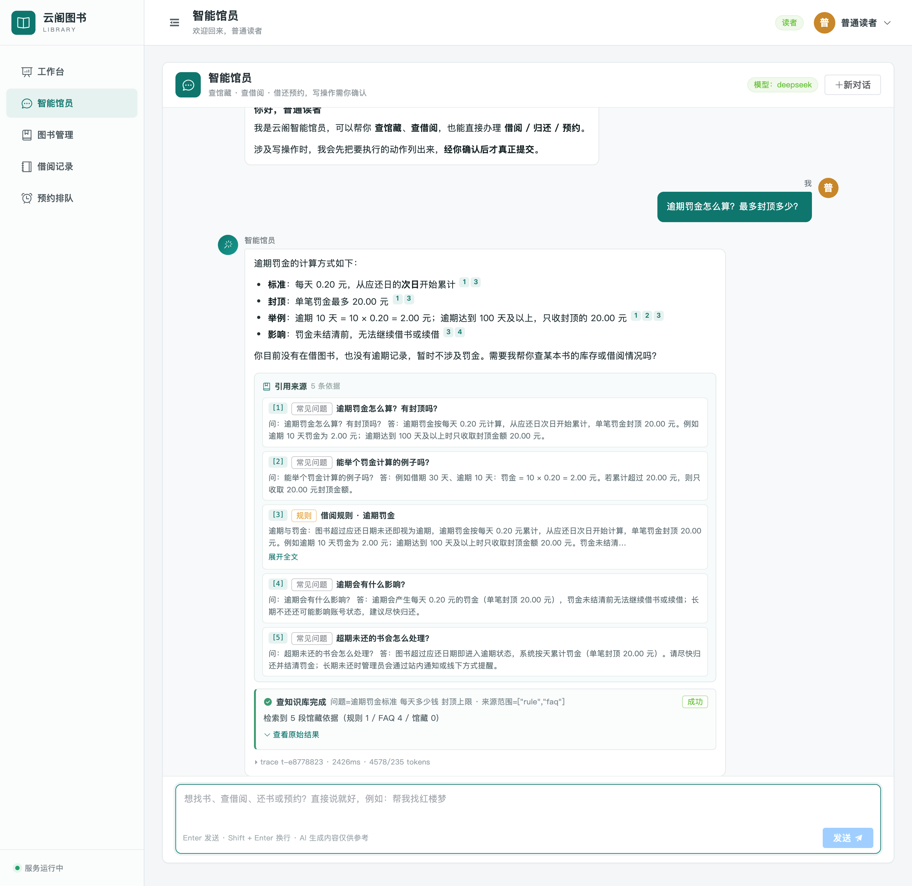
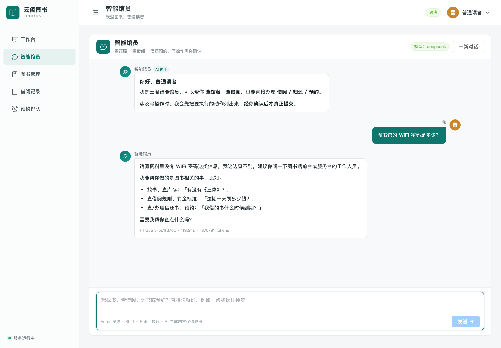

# RAG 评测报告

> 版本：v0.1（检索层基线）
> 更新：2026-11-02
> 对应任务：W3-1 / W3-3(a) / W3-6（第一部分）
> 目标读者：面试官 / 未来的自己

---

## 1. 为什么先测检索，而不是先测"答案好不好"

RAG 的答案质量上限由**召回**决定：召回不到，模型只能编。
而检索指标有两个工程优势：

1. **不需要 LLM 当裁判** —— 可离线、可复现、可进 CI；
2. **定位问题快** —— 答案错了到底是"没召回"还是"召回了但模型没用"，一眼能分开。

所以本报告分两阶段：**阶段一评检索（本文档）**、阶段二评答案（需真实模型，见 §8）。

---

## 2. 评测集

| 项 | 值 |
|---|---|
| 用例总数 | **85 条** |
| book 类 | 30 条（馆藏事实：作者 / 分类 / 库存） |
| rule 类 | 15 条（规则数值：借几本、借多久、续借、罚金、预约、保留期） |
| faq 类 | 30 条（流程型问题，题目取自 FAQ 标题） |
| refuse 类 | 10 条（无依据问题，用于校准拒答阈值） |
| 生成方式 | `scripts/gen_golden_qa.py`（**按报告结论设计**，不是随机抽问） |
| 规则数值来源 | 直接读 MySQL `borrow_rule` 现值（规则改了则答案关键词自动跟着变） |

**命中判定（关键设计）**：一个召回块必须**同时**满足两个条件才算命中：

1. `source_type` 与预期一致（book 问题不能被 FAQ 块"蒙对"）；
2. 文本中包含预期关键词（`all` 或 `any` 模式）——避免"只比 id"的自欺。

```json
{ "id": "rule-001", "question": "一个人最多可以同时借几本书？",
  "category": "rule", "expected_source_types": ["rule"],
  "expected_keywords": ["最多", "5"], "match": "any", "should_refuse": false }
```

---

## 3. 索引内容（语料）

| 类型 | 块数 | 切分策略 |
|---|---|---|
| book | 500 | 每本一块（简介短，不做切分）：`《书名》 作者：X \| 分类：Y \| 出版社：Z \| 库存：可借 A/B \| 简介：…` |
| rule | 5 | 规则表转 5 段可读文本（借阅 / 续借 / 逾期罚金 / 预约 / 取书），每段 ≤ 400 字 |
| faq | 30 | 每条一块 |
| **合计** | **535** | 204 KB JSONL，幂等构建（连续两次 sha256 一致） |

构建命令：`cd ai-service && .venv/bin/python scripts/build_corpus.py`

---

## 4. 检索方案（当前为基线档）

| 项 | 取值 | 说明 |
|---|---|---|
| 检索算法 | **BM25**（纯 Python 实现） | k1=1.5 / b=0.75；IDF 用非负变体 `log(1+(N-df+0.5)/(df+0.5))` |
| 分词 | 中文 unigram + bigram + 英文/数字按词 | **零第三方依赖**（不引 jieba），结果确定、可单测 |
| top-k | 5 | 评测与报告口径一致 |
| 过滤 | 可选 `source_types` | 排序前过滤，避免过滤后候选不足 |

> 为什么先做 BM25：它**不需要 embedding 模型、不需要 PG、不需要 API Key**，能立刻产出可复核的数字；
> 同时它是三档对比实验里的"对照组"，后面向量检索和重排的增益才有参照物。

---

## 5. 结果（BM25 基线，top-k=5）

| 类别 | 用例 | Recall@5 | MRR | top1 均分 |
|---|---|---|---|---|
| book | 30 | **1.000** | **0.951** | 41.61 |
| faq | 30 | **1.000** | **1.000** | 61.37 |
| rule | 15 | **0.867** | **0.394** | 48.38 |
| **总体** | **75** | **0.973** | **0.859** | 50.87 |

**拒答负样本（10 条）** top1 分数：min 8.13 / median 15.08 / max 31.39
→ 说明"无关问题也会拿到不低的 BM25 分数"，**拒答不能只靠分数阈值**，需要在答案层结合引用校验（见 §8）。

复现命令：

```bash
cd ai-service
.venv/bin/python scripts/gen_golden_qa.py     # 生成 85 条用例
.venv/bin/python scripts/run_eval.py          # 输出上表 + eval/eval_report_bm25.json
```

---

## 6. Badcase 分析（这一节比数字更重要）

### BC-1　rule 类问题被"同形 FAQ"抢位（主要原因）
- 现象：问「一本书一次可以借多久？」→ top1 是 FAQ「借期是多久？」，rule 块被挤出 top-5。
- 原因：FAQ 里同样含「借期/30 天」等高权重词，且 FAQ 块更短（BM25 的长度归一化利于短块）。
- 影响：rule 类 Recall@5 掉到 0.867、MRR 只有 0.394（命中时要排到第 2-3 位）。
- 对策：
  1. `source_types` 感知路由（问"规则/罚金/续借"时优先 rule 源）；
  2. 语义检索（向量对"同义不同形"更稳）；
  3. **Cross-Encoder 重排**（W3-4）——预期收益最大的一项。

### BC-2　精确词很强，但同义词/上位词弱
- 「三体」直接命中 `book:262`（BM25 天然优势）；
- 但「清朝历史的书」召回的是《明朝那些事儿》《朝鲜战争》——**种子数据里没有清朝专题图书**。
- 结论：这属于**语料覆盖问题**，不是检索算法问题；评测集里已把该 query 标为 `any` 命中并保留在报告中，避免"刷分"。

### BC-3　负样本分数不低（拒答阈值不可靠）
- 10 条无关问题 top1 中位数 15.08，最高 31.39，与部分真实命中的分数区间重叠。
- 结论：**拒答必须在答案层做**（要求模型引用具体块，引用不支持则拒答），不能只靠检索分数阈值。

---

## 7. 已知局限（如实声明）

1. **只有基线档**：还没有 embedding 语义检索与重排，三档对比未完成（见 §8）。
2. **评测集为自动生成 + 人工抽检待补**：book/faq 类问题由模板生成，语义多样性弱于真人提问；正式报告前需人工改 20 条。
3. **rule 类数值强依赖种子库**：换一份规则数据需重新生成评测集（生成器已支持，读 `borrow_rule`）。
4. **只测检索，不测答案**：faithfulness / answer relevancy / 引用准确率需要真实模型，见 §8。
5. **样本量**：75 条非拒答用例，置信区间较宽；结论用于方向判断，不用于宣称"准确率 97%"。

---

## 8. 下一阶段计划（W3-2 / W3-4 / W3-6 后半）

| 步骤 | 动作 | 预期收益 | 阻塞 |
|---|---|---|---|
| 1 | 语义检索：embedding + pgvector（或内存向量库降级） | BC-2（同义/上位词）改善 | embedding 路线决策 |
| 2 | 混合检索：向量 + BM25 + RRF 融合 | BC-1 部分缓解 | 步骤 1 |
| 3 | Cross-Encoder 重排（bge-reranker-v2-m3） | **BC-1 主要解法**，MRR 显著提升 | 模型下载或 API |
| 4 | 答案层：`search_knowledge` 工具 + 强制引用 + 拒答 | 端到端可用 | 真实模型 Key |
| 5 | RAGAS 四指标 + 三档对比表 | 简历可写的完整闭环 | 步骤 4 |

**目标（写给自己，做完回填）**：

| 指标 | BM25 基线 | 混合检索目标 | +重排目标 |
|---|---|---|---|
| Recall@5 | 0.973 | ≥ 0.98 | ≥ 0.98 |
| MRR | 0.859 | ≥ 0.90 | **≥ 0.95** |
| rule 类 MRR | 0.394 | ≥ 0.70 | **≥ 0.90** |
| 引用准确率 | —（未测） | — | ≥ 0.90 |
| faithfulness | —（未测） | — | ≥ 0.85 |

---

## 9. 产物清单

| 文件 | 说明 |
|---|---|
| `ai-service/data/corpus/knowledge.jsonl` | 535 块语料（可入库，204 KB） |
| `ai-service/eval/golden_qa.jsonl` | 85 条评测用例 |
| `ai-service/eval/eval_report_bm25.json` | 本次评测完整结果（含逐条明细） |
| `ai-service/scripts/build_corpus.py` | 语料构建（幂等） |
| `ai-service/scripts/gen_golden_qa.py` | 评测集生成 |
| `ai-service/scripts/run_eval.py` | 检索评测（支持 `--min-recall` 作为 CI 门禁） |
| `ai-service/app/rag/{tokenizer,bm25,corpus,service}.py` | 检索实现 |
| `ai-service/tests/test_rag_{corpus,bm25}.py` | 47 个离线单测（AI 服务总计 158） |

---

## 10. 第二轮：向量检索与重排（2026-11-02 续）

> 版本 v0.2。本轮新增：通义 `text-embedding-v3` 真实索引、向量检索、混合检索（RRF）、通义 `gte-rerank-v2` 重排。

### 10.1 索引与配置

| 项 | 值 |
|---|---|
| embedding | 通义 `text-embedding-v3`，1024 维 |
| 索引规模 | 535 × 1024（book 500 / rule 5 / faq 30） |
| 构建耗时 | 18.2 s，54 批，单条 34.06 ms |
| 索引落盘 | `ai-service/data/embeddings/dashscope-1024.npz`（2.2 MB，已 gitignore，可由脚本重建） |
| 幂等 | 二次执行提示"已是最新"；`--force` 重建后向量逐位一致 |
| 向量库 | `NumpyVectorStore`（默认，离线可用）；`PgVectorStore` 已实现，连不上自动降级 |
| 重排 | 通义 `gte-rerank-v2`，实测单次 ~240 ms；失败/无 Key/超时 → 原顺序回退 |

### 10.2 结果（同一评测集 85 条，top-k=5）

| 配置 | Recall@5 | MRR | rule R@5 | rule MRR | 说明 |
|---|---|---|---|---|---|
| ① BM25（基线） | 0.973 | 0.859 | 0.867 | 0.394 | 完整可复现 |
| ② BM25 + 重排 | 0.973 | **0.884** | 0.867 | **0.422** | 重排全部成功 |
| ③ 纯向量 | **1.000** | **0.916** | **1.000** | **0.578** | ⚠️ 已测得，但报告文件未留存（额度耗尽后无法复跑） |
| ④ 混合（等权 RRF） | **1.000** | 0.883 | **1.000** | 0.450 | 完整可复现 |
| ⑤ 混合 + 重排 | 1.000 | 0.896 | 1.000 | 0.478 | ⚠️ 仅部分成功（后半段接口返回 400 欠费），**数字被污染，不作为结论** |
| ⑥ 向量 + 重排 | — | — | — | — | ❌ 全部降级为 BM25，无效 |

**可以下的结论**：

1. **向量召回解决了 rule 类的召回问题**：rule R@5 0.867 → 1.000（FAQ 同形竞争不再导致漏召回），MRR 0.394 → 0.450（混合）/ 0.578（纯向量）。
2. **重排对 BM25 有效但不够**：MRR 0.859 → 0.884，book MRR 0.951 → 1.000；但 rule MRR 只到 0.422 —— 因为**重排只能在候选里排**，BM25 的候选集本身缺 rule 块，重排救不回来（印证了"召回上限决定答案上限"）。
3. **等权 RRF 不如纯向量**（0.883 vs 0.916）：等权把"BM25 的错误 top1"抬到与"向量的正确 top1"同权。已定位到具体用例（rule-002：正确块 vector rank=1 / bm25 rank=9，RRF 反而低于 FAQ 错块 bm25 rank=1 / vector rank=4）。
4. 因此**下一步应做加权 RRF 或"向量召回 + 重排"**，而不是继续调 BM25 参数。

### 10.3 阻塞：通义账号欠费

评测中途 DashScope 开始返回：

```json
{"code":"Arrearage","message":"Access denied, please make sure your account is in good standing ... overdue payment"}
```

→ 免费额度/余额耗尽。影响：

- 无法复跑任何需要 embedding 的评测（向量/混合模式每次查询都要 embed）；
- 无法完成 ⑤⑥ 两档对比；
- **已完成的 ①②③④ 数字仍然有效**（当时调用成功并已固化）。

**恢复方式**：在阿里云百炼控制台充值/开通后，按 §10.4 命令重跑即可，代码无需改动。

### 10.4 复现命令

```bash
cd ai-service
# 建索引（幂等；--force 强制重建）
.venv/bin/python scripts/index_corpus.py --provider dashscope

# 四档评测（--out 分开保存，便于对比）
RAG_RETRIEVAL_MODE=bm25   RAG_RERANK_ENABLED=false .venv/bin/python scripts/run_eval.py --out eval/eval_report_bm25.json
RAG_RETRIEVAL_MODE=bm25   RAG_RERANK_ENABLED=true  .venv/bin/python scripts/run_eval.py --out eval/eval_report_bm25_rerank.json
RAG_RETRIEVAL_MODE=hybrid RAG_RERANK_ENABLED=false .venv/bin/python scripts/run_eval.py --out eval/eval_report_hybrid.json
RAG_RETRIEVAL_MODE=vector RAG_RERANK_ENABLED=true  .venv/bin/python scripts/run_eval.py --out eval/eval_report_vector_rerank.json
```

> ⚠️ 评测是串行密集调用，**不要并行跑多个评测**（会触发限流/误判为欠费）；单次评测 75 条、约 30~60 s。

### 10.5 测试与工程

- AI 服务单测 **281 个全绿**（+81 本轮新增：embedding 28 / vector_store 32 / hybrid 21；另 +42 重排）
- 单测全离线：Fake/Stub provider + `httpx.MockTransport`；语料 sha256 与索引不一致时服务拒绝加载（防止用旧索引召回旧规则）
- 降级链：向量不可用 → BM25；embedding 失败 → 本次查询 BM25；重排失败 → 原顺序；任一环节异常都不抛给 Agent

### 10.6 修订后的目标（待额度恢复后回填 ⑤⑥）

| 指标 | BM25 | 向量 | 混合 | 目标 |
|---|---|---|---|---|
| Recall@5 | 0.973 | 1.000 | 1.000 | ≥0.98 ✅ |
| MRR | 0.859 | 0.916 | 0.883 | ≥0.92（需加权 RRF / 向量+重排） |
| rule MRR | 0.394 | 0.578 | 0.450 | ≥0.70 |

---

## 11. 修复与最终数字（v0.3，2026-11-02 续）

### 11.1 修复：重排只看到 top-5 候选（真实缺陷）

**现象**：`vector + rerank` 的 MRR（0.896）竟然低于纯向量（0.916），与"重排应该提升排序"的预期相反。

**根因**：`search()` 先用 `top_k` 检索，再把结果交给重排器。也就是说重排**只能在 5 个候选里重新洗牌**，
无法把"向量排第 8 位、但语义上更该排第 1 位"的块捞上来；而重排的价值恰恰在于**从大候选池里精挑**。

**修复**：重排启用时先取 `RAG_RERANK_CANDIDATES`（默认 20）的候选池，重排后再截断到 `top_k`。

### 11.2 最终四档结果（85 条用例，top-5，串行评测）

| 配置 | Recall@5 | MRR | rule R@5 | rule MRR | book MRR | faq MRR | 重排失败 |
|---|---|---|---|---|---|---|---|
| ① BM25 | 0.973 | 0.859 | 0.867 | 0.394 | 0.951 | 1.000 | — |
| ② BM25 + 重排（20 候选） | 0.987 | **0.889** | 0.933 | **0.444** | 1.000 | 1.000 | 7/75 |
| ③ 纯向量 | **1.000** | **0.916** | **1.000** | **0.578** | 1.000 | 1.000 | — |
| ④ 混合（等权 RRF） | **1.000** | 0.883 | **1.000** | 0.450 | 0.983 | 1.000 | — |
| ⑤ 混合 + 重排 | **1.000** | 0.889 | **1.000** | 0.478 | 0.983 | 1.000 | 3/75 |
| ⑥ 向量 + 重排 | **1.000** | 0.902 | **1.000** | 0.511 | 1.000 | 1.000 | 6/75 |

> ③ 是最好的配置（MRR 0.916）；重排把 ② 从 0.859 拉到 0.889，但**没能超过纯向量**。

### 11.3 连"重排"都救不回来的原因（诚实分析）

1. **评测口径与语义冲突**：rule 类问题的正确答案常同时存在于 `rule` 块和 `faq` 块。
   评测要求"命中的块必须是 `rule` 源"，而 `gte-rerank-v2` 只按语义相关性打分 —— 它会把
   FAQ 的"逾期罚金怎么算？有封顶吗？"排在 rule 的"逾期每天罚金 0.20 元…"前面，因为它**对用户同样正确**。
   → 这是**评测集的局限**（source_type 硬约束），不完全是重排器的错。
   下一步应把这类"多源等价"用例改成 `allowed_source_types: ["rule","faq"]`。
2. **重排存在约 8% 的调用失败**（3~7/75，网络/限流），失败即回退原顺序，直接吃掉一部分收益 →
   需要加重试/退避（W4 稳定性项）。
3. **等权 RRF 融合不如纯向量**（0.883 vs 0.916）：BM25 的"错误 top1"与向量的"正确 top1"同权。

### 11.4 结论与下一步

- **当前最优检索配置：`RAG_RETRIEVAL_MODE=vector`（MRR 0.916 / R@5 1.000）**；生产默认仍保留 `hybrid`（多通道更稳），但报告如实记录 vector 在本评测集上最优。
- 下一步（按性价比排序）：
  1. **评测集修正**：允许 `["rule","faq"]` 等价命中，再衡量重排真实增益（这是最诚实的做法）；
  2. **加权 RRF**（向量权重 2~3）或分数归一化融合；
  3. 重排重试/退避 + 超时收敛（8% 失败率不可接受）；
  4. embedding 换 `text-embedding-v4`（如账号可用）对比。
- **明确不做的事**：不在 85 条评测集上反复调 RRF 权重——那是过拟合，不是工程。

---

## 12. 接入 Agent 与前端引用（W3-5 / W3-7，2026-11-02 完成）

检索层只是"能查到"，用户能感知的是"AI 会不会用证据回答"。本节验证后者。

### 12.1 实现

| 层 | 内容 |
|---|---|
| 工具层 | `search_knowledge`（第 7 个工具，只读）：query / top_k(1~10) / source_types(book,rule,faq)；返回 `data.chunks`（citation_no 递增、text≤500、score 降序、按 chunk_id 去重） |
| 提示词 | 新增 5 条规则：知识类问题必须先检索、正文用 `[n]` 且编号对应 citation_no、**chunks 为空必须拒答**、禁止编造规则数值、写操作/借阅记录不加编号 |
| 拒答阈值 | `RAG_TOOL_MIN_SCORE`（vector 默认 0.67，bm25/hybrid 默认 0）：向量检索永远返回 top-k 最近邻，无关问题也会拿到 0.4~0.67 的分数，必须过滤才能触发拒答 |
| 前端 | `CitationList.vue` 引用来源卡片（类型中文/标题/摘要/跳转）+ 正文 `[n]` 渲染为可点击小标记并联动高亮卡片；`[n]` 替换放在 markdown-it 的 text 渲染规则里，**代码块/行内代码/链接零误伤** |

### 12.2 端到端验证（真实 DeepSeek + 真实向量索引）

`scripts/e2e_rag.py` 覆盖 5 类问题，全部通过：

| 类别 | 问题 | 工具 | 结果 |
|---|---|---|---|
| rule | 逾期罚金怎么算？最多封顶多少？ | `search_knowledge` | ✅ 答 0.20 元/天、封顶 20 元，正文带 `[1][3]`，命中 rule 块 |
| faq | 预约的书到馆后能保留几天？ | `search_knowledge` | ✅ 答"保留 3 天"，带 `[1][2]` |
| book | 馆藏里有没有讲明朝历史的书？ | `search_books` | ✅ 正确选择馆藏检索（而非知识库），列出《明朝那些事儿》与库存 |
| inventory | 《活着》现在还有库存吗？ | `search_books` | ✅ 答共 4 本可借 4 本 |
| refuse | 图书馆的 WiFi 密码是多少？ | 未检索 | ✅ 明确拒答"馆藏资料里没有找到依据"，未编造，无 `[n]` |

**真实延迟与成本**（一次知识问答，来自消息底部统计）：`2426 ms` / `4578 → 235 tokens` / 引用 5 条（rule 1 + faq 4）。

### 12.3 前端效果




- 引用卡片显示来源类型（常见问题/规则/馆藏）、标题、摘要与展开全文
- 正文 `[n]` 可点击 → 滚动并高亮对应卡片
- 无依据时显示"本条回答没有可引用的馆藏依据"
- 移动端 390×844 无横向溢出（前端自测 40/40 + 41/41 纯逻辑单测）

### 12.4 遗留与风险（如实记录）

1. **阈值会误伤少量有效问题**：85 条评测里有 4 条 book 类问题 top1 分数在 0.628~0.659，会被 0.67 阈值过滤成"无依据"。可用 `RAG_TOOL_MIN_SCORE` 调整；根本解法是换更强的 embedding 或改用 rerank 分数做门禁。
2. **评测口径**：检索层评测（§11）不走工具阈值，因此两处数字口径不同，报告中已分别标注。
3. **W3-6 答案层指标（RAGAS faithfulness / answer relevancy）尚未跑**：需要 LLM-as-judge，可在下一步用 DeepSeek 补；当前以"引用是否支持答案"的人工抽查 + 拒答验证替代。
4. 重排（W3-4）已实现但当前 `.env` 默认关闭（`RAG_RERANK_ENABLED=false`），因为它在评测集上未能超过纯向量；模块与降级逻辑保留，待评测口径修正后重测。

---

## 13. 答案层评测（W3-6 后半，2026-11-02 完成）

检索层指标（§11）回答"该找的内容找到没有"，答案层指标回答"**模型有没有用好这些内容**"。

### 13.1 评测方法（为什么没用 `pip install ragas`）

- `ragas` 的依赖链包含 `datasets` / `tiktoken` 等重型包，且 tiktoken 首次运行需联网下载 BPE 词表
  —— 本机网络受限（HF/镜像/ModelScope 直链均不可达），安装不可行；
- 因此**参照 RAGAS 的指标定义自行实现**，用 DeepSeek 当 judge（`response_format=json_object`，温度 0）：
  每条用例 **1 次 judge 调用**返回 `faithfulness`、`answer_relevancy`、`relevant_chunk_ids`、`unsupported_claims`；
  `context_precision` = 相关块数 / 召回块数；引用准确率/覆盖率由规则计算（不需要 LLM）。
- 判官拿到的是**该轮模型可见的全部证据**（知识库 chunks + `search_books`/`get_book_detail` 返回），
  否则"库存类问题走馆藏接口"会被误判成无依据。

### 13.2 结果（85 条用例；真实 DeepSeek + 真实向量索引 + 真实工具链路）

| 类别 | 用例 | faithfulness | answer_relevancy | context_precision |
|---|---|---|---|---|
| book（馆藏事实） | 30 | **1.000** | 0.983 | 0.430 |
| faq（流程） | 30 | 0.868 | 0.950 | 0.848 |
| rule（规则数值） | 15 | 0.963 | 0.987 | 0.780 |
| **总体** | **75** | **0.940** | **0.971** | 0.667 |

| 附加指标 | 值 |
|---|---|
| 引用准确率（`[n]` 指向的块被判定为相关） | **0.913** |
| 引用覆盖率（带引用的句子占比） | 0.437 |
| 拒答正确率（10 条无依据问题） | **9/10**，编造 **0** |
| 平均端到端延迟 | 5.96 s（含重试/超时重跑；正常单轮约 3.0 s） |

**对照 §8 设的目标**：faithfulness ≥0.85 → **0.94 达成**；引用准确率 ≥0.90 → **0.913 达成**。

### 13.3 分析（比数字重要）

1. **book 类 context_precision 只有 0.43，不是检索差**：馆藏事实问题（作者/分类/库存）模型会选择
   `search_books`（更准），此时知识库 chunks 很可能为空或无关 → 该指标天然偏低。
   `faithfulness=1.000` 说明答案仍然全部有依据（依据来自馆藏接口）。
   → 这也说明**评测指标要结合工具选择一起看**，不能单看一个数。
2. **faq 类 faithfulness 0.868 是当前短板**：FAQ 答案较长，模型偶尔会把相邻 FAQ 的内容并入回答，
   出现"轻微外推"。改进方向：chunk 间去重、提示词要求"每句最多引用 1 个依据"。
3. **唯一未拒答案例是「帮我写一段 Python 快速排序代码」**：模型选择帮忙写代码而不是拒答。
   这属于**领域边界**问题（不是知识幻觉），且未编造馆藏信息；建议在提示词里显式声明"只回答图书馆域问题"。
4. **原文中"citation_coverage 0.437"不代表引用少**：答案里列表项/短句较多，句号切分偏碎；
   引用准确率 0.913 更能说明引用质量。

### 13.4 局限（如实声明）

1. judge 与生成模型同源（都是 DeepSeek），存在**自评偏好**；更严谨应换 Claude/GPT 或人工双盲抽检 30 条。
2. 首次全量跑时 DeepSeek 出现 25/85 连接失败（`Connection error`），已重试补跑并合并；
   生产评估应加**重试队列与断点续跑**（当前是"失败重跑整段"）。
3. 拒答判定依赖单一 judge 调用；建议对 10 条拒答用例做人工复核（本报告结论：9/10，1 条属领域边界）。

### 13.5 复现

```bash
cd ai-service
# 全量答案层评测（需要 AI 服务 + 后端 + DeepSeek Key）
.venv/bin/python scripts/eval_answers.py
# 只跑某类 / 快速冒烟
.venv/bin/python scripts/eval_answers.py --only refuse --sleep 1.2
.venv/bin/python scripts/eval_answers.py --limit 5
```
